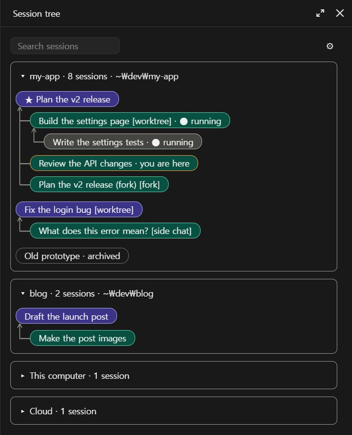
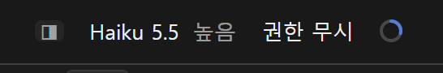
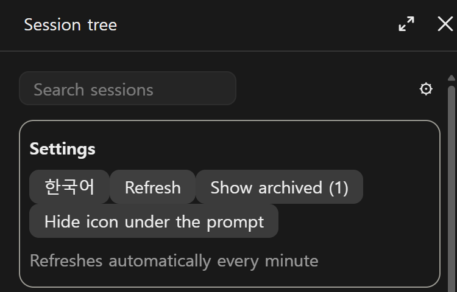

# Session Tree

[English](README.md)

Claude 데스크톱 앱에서 어떤 세션이 어떤 세션을 시작했는지 보여 주는 옆 패널입니다. 사이드바는 세션을 목록으로 보여 주지만, Session Tree는 폴더별 가계도로 그려서 작업 구조를 한눈에 볼 수 있게 합니다.

Claude Code mod라서 데스크톱 앱 안에서 돌아가고, 서버·계정·API 키가 필요 없으며 네트워크 요청을 하지 않습니다.



*스크린샷은 `/session-tree demo`의 예시 데이터입니다.*

## 기능

- **가계도:** 화살표가 자식 세션에서 보고받는 부모 세션 쪽을 가리킵니다.
- **폴더:** 사이드바처럼 폴더별로 묶고, 폴더마다 접을 수 있습니다.
- **세션 종류:** 워크트리, 포크, 사이드 채팅 세션에 표시가 붙습니다.
- **상태:** 즐겨찾기 세션에는 ★, 실행 중인 세션에는 ● 표시가 붙습니다.
- **검색:** 제목으로 찾습니다. 찾은 세션은 부모 아래 제자리에 그대로 나옵니다.
- **보관 세션:** 기본으로 숨기고, 버튼으로 볼 수 있습니다.
- **눌러서 열기:** 카드를 누르면 앱에서 그 세션을 엽니다.
- **간편 여닫기:** 입력창 아래의 흐린 아이콘이나 `/session-tree`로 패널을 열고 닫습니다. 아이콘은 설정에서 숨길 수 있습니다.
- **한국어와 영어:** 고른 언어를 기억합니다.

패널이 열려 있으면 1분마다 스스로 새로 고칩니다.

## 설치

Claude 데스크톱 앱과 Claude Code CLI가 필요합니다. 터미널에서 실행합니다.

```bash
claude plugin marketplace add dshw1234-dot/session-tree
claude plugin install session-tree@session-tree --scope user
```

새 세션을 열고 `/session-tree`를 입력합니다. 다시 입력하면 패널이 닫힙니다. 입력창 아래의 흐린 아이콘도 같은 일을 합니다. ◨은 패널을 열고 □은 닫습니다. 패널 오른쪽 위 ⚙ 버튼을 누르면 설정이 열립니다.





자동 업데이트를 쓰려면 터미널의 `/plugin`에서 **Marketplaces** 항목으로 들어가 이 마켓플레이스의 자동 업데이트를 켭니다. 직접 업데이트하려면 다음을 실행합니다.

```bash
claude plugin update session-tree@session-tree
```

## 토큰 사용

패널을 그리거나 새로 고치거나 버튼을 눌러도 모델을 부르지 않습니다. `/session-tree` 명령이 대화에 남기는 한 줄을 다음 메시지 때 모델이 읽는 것이 유일한 작은 비용입니다.

## 읽고 보내는 것

이 절은 이 모드의 개인정보 처리방침이기도 합니다.

**읽는 것.** 데스크톱 앱이 내 컴퓨터에 둔 세션 파일(제목, 폴더, 부모 관계, 날짜)과, 저장소 이름을 알기 위한 각 프로젝트의 `.git/config`입니다. 세션 제목과 폴더 경로에는 이름 같은 개인정보가 들어 있을 수 있습니다.

**저장하는 것.** 내 컴퓨터에 설정만 저장합니다. 언어, 보관 세션 표시 여부, 아이콘 숨김 여부, 접은 폴더(폴더 경로로 저장)입니다. 이 모드에는 서버가 없고, 그 밖의 데이터 사본을 두지 않습니다.

**보내는 것.** 없습니다. 이 모드는 네트워크 요청을 하지 않습니다. 새 버전은 설치 항목에 적은 마켓플레이스 자동 업데이트로 받으세요.

**스스로 부르는 도구.** 패널이 열려 있으면 모델의 요청 없이 약 1분마다 부릅니다. 권한 설정에서 이미 허용된 경우에만 부르므로 권한 창을 띄우지 않습니다.

- `ListAgents`: 클라우드 세션의 제목을 알기 위해 부릅니다.
- `mcp__ccd_session_mgmt__list_sessions`: 실행 중인 세션을 알기 위해 부릅니다.

허용되지 않은 도구는 건너뛰며, 그 정보는 패널에 나오지 않습니다. 도구의 답은 패널에만 쓰이고, 어디로도 보내지 않으며 대화에도 들어가지 않습니다.

**실행하는 프로그램.** 세션 카드를 눌렀을 때 그 세션을 앱에서 열기 위해서만 실행합니다. Windows는 `rundll32 url.dll,FileProtocolHandler`, macOS는 `open`입니다. 인수는 `claude://claude.ai/epitaxy/<세션 id>` 하나이고, id는 영문자, 숫자, 하이픈으로 된 로컬 세션 id여야 합니다. 그 밖의 프로그램은 실행하지 않습니다.

**훅.** `session.start`는 명령을 등록하고 설정을 복원합니다. `command.run`은 `/session-tree`에 답해 패널을 열거나 닫습니다. `ui.close`는 패널을 닫을 때 아이콘 모양을 맞춥니다. `ui.render`는 패널과 입력창 아래 아이콘을 그립니다. 프롬프트, 모델 지침, 다른 도구 호출은 바꾸지 않습니다.

문의와 문제 제보는 [Issues](https://github.com/dshw1234-dot/session-tree/issues)로 보내 주세요.

## 한계

- **Windows와 macOS.** 데스크톱 앱이 이 둘에서 돌아갑니다. 시험은 Windows에서만 했고, macOS 지원 코드는 그 환경에서 실행해 보지 않았습니다. 제보를 환영합니다.
- **앱이 업데이트되면 고장 날 수 있습니다.** 세션 파일은 공개 API가 아니라 앱 내부 형식입니다.
- **클라우드 세션은 제목만 나옵니다.** 모드가 알 수 있는 정보가 아니어서 폴더, 부모 관계, 눌러서 열기를 지원하지 않습니다.
- **실행 상태에 지금 세션은 나오지 않고,** 최대 1분 늦을 수 있습니다.

## 개발

```bash
claude plugin validate .
claude plugin test .
```

`hooks/tree.ts`가 나무를 만들고, `hooks/register.tsx`가 패널을 그리며, `hooks/strings.ts`에 두 언어의 문구가 있습니다.

## 함께 쓰면 좋은 mod

- [RC Panel](https://github.com/dshw1234-dot/rc-panel): Remote Control이 켜진 세션을 모아 보여 주고, 그 세션으로 이동시켜 끌 수 있게 합니다. 입력창 아래에서 `RC` 버튼이 ◨ 옆에 놓입니다.

## 라이선스

[MIT](LICENSE)
