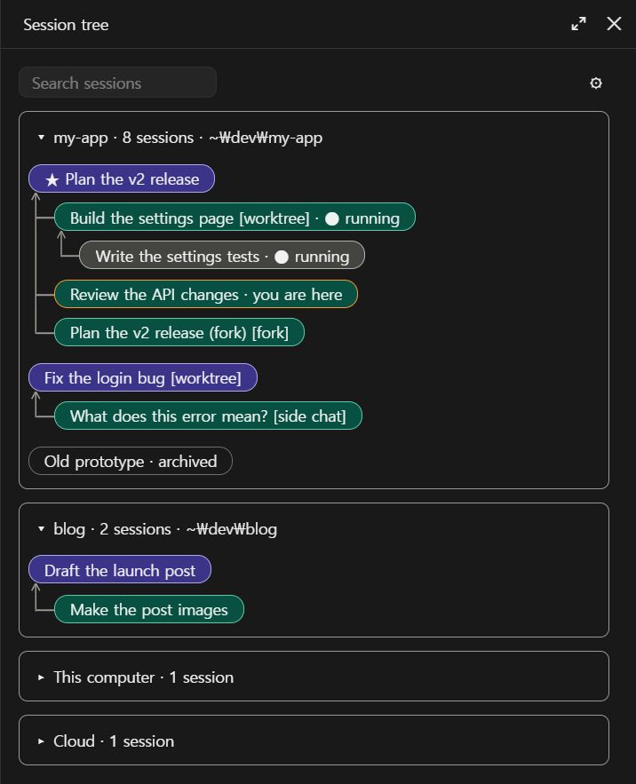
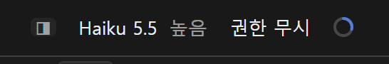
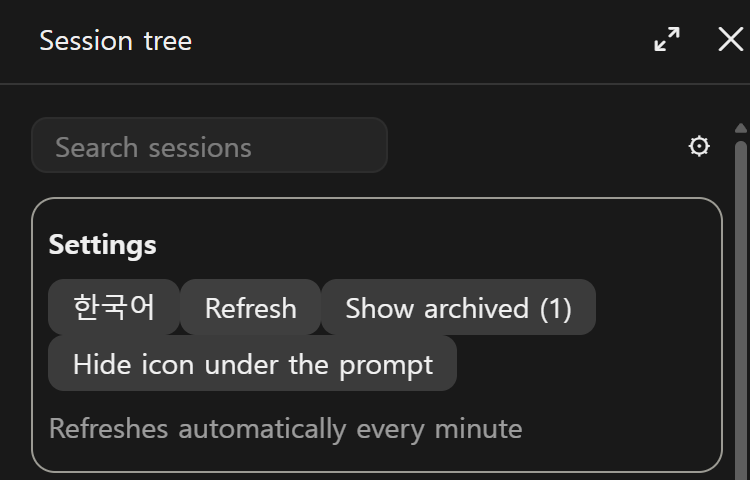

# Session Tree

[한국어](README.ko.md)

A side panel for the Claude desktop app that shows which session started which. The sidebar lists your sessions; Session Tree draws them as a family tree, grouped by folder, so you can see the shape of your work at a glance.

It is a Claude Code mod: it runs inside the desktop app, needs no server, account or API key, and makes no network requests.



*The screenshot uses the sample data from `/session-tree demo`.*

## Features

- **Family tree:** arrows point from each child session to the parent it reports to.
- **Folders:** sessions are grouped like the sidebar, and each folder can be collapsed.
- **Session types:** worktree, fork and side chat sessions are labelled.
- **Status:** starred sessions get a ★ and running sessions get a ● marker.
- **Search:** filter by title. Matching sessions stay in place under their parents.
- **Archived sessions:** hidden by default, with a button to show them.
- **Click to open:** click a card to open that session in the app.
- **Korean and English:** your choice is remembered.
- **Quick toggle:** a faint icon under the prompt opens and closes the panel, and so does `/session-tree`. You can hide the icon in the settings.

It refreshes by itself every minute while the panel is open.

## Install

Requires the Claude desktop app and the Claude Code CLI. In a terminal:

```bash
claude plugin marketplace add dshw1234-dot/session-tree
claude plugin install session-tree@session-tree --scope user
```

Start a new session and type `/session-tree`. Type it again to close the panel. The faint icon under the prompt does the same: ◨ opens the panel and □ closes it. The ⚙ button at the top right of the panel opens the settings.





To get updates automatically, turn on auto-update for this marketplace under **Marketplaces** in `/plugin` in a terminal. To update by hand:

```bash
claude plugin update session-tree@session-tree
```

## Token use

Drawing the panel, refreshing it and pressing its buttons make no model calls. The one small cost is the line `/session-tree` leaves in the conversation, which the model reads on your next message.

## What it reads and sends

This section is also the mod's privacy policy.

**Reads.** The session files the desktop app keeps on your computer (titles, folders, parent links, dates) and each project's `.git/config` for its repository name. Session titles and folder paths can contain personal details such as your name.

**Stores.** Only your settings, on your computer: language, whether archived sessions are shown, whether the icon is hidden, and which folders are collapsed (kept as folder paths). The mod has no server and keeps no other copy of your data.

**Sends.** Nothing. The mod makes no network requests. For new versions, use the marketplace auto-update described under Install.

**Tools it calls by itself.** While the panel is open, about once a minute, without the model asking, and only if your permission settings already allow them, so that it never opens a permission prompt:

- `ListAgents`, for the titles of cloud sessions.
- `mcp__ccd_session_mgmt__list_sessions`, for which sessions are running.

If either tool isn't allowed, the mod skips it and that information doesn't appear. The answers stay in the panel. They aren't sent anywhere and they don't enter the conversation.

**Programs it starts.** Only when you click a session card, to open that session in the app: `rundll32 url.dll,FileProtocolHandler` on Windows, or `open` on macOS. The only argument is `claude://claude.ai/epitaxy/<session id>`, and the id must be a local session id made of letters, digits and hyphens. The mod starts no other program.

**Hooks.** `session.start` registers the command and restores your settings. `command.run` answers `/session-tree` by opening or closing the panel. `ui.close` keeps the icon right when you close the panel. `ui.render` draws the panel and the icon under the prompt. The mod doesn't change your prompts, the model's instructions or other tool calls.

Questions and problem reports go to [Issues](https://github.com/dshw1234-dot/session-tree/issues).

## Limitations

- **Windows and macOS.** The desktop app runs on these two. Tested on Windows only; macOS support is written but has not been run there. Reports are welcome.
- **It can break when the app updates.** The session files are the app's internal format, not a public API.
- **Cloud sessions show titles only.** They have no folder, no parent and no click-to-open, because that information isn't available to a mod.
- **Running status doesn't cover the session you are in,** and it can lag by up to a minute.

## Development

```bash
claude plugin validate .
claude plugin test .
```

`hooks/tree.ts` builds the tree, `hooks/register.tsx` draws the panel and `hooks/strings.ts` holds the text in both languages.

## See also

- [RC Panel](https://github.com/dshw1234-dot/rc-panel): lists the sessions that have Remote Control on and opens each one so you can turn it off there. Its `RC` button sits next to ◨ below the prompt.

## License

[MIT](LICENSE)
